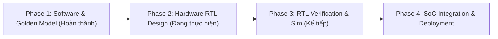

# FPGA-Based Hardware Accelerator for Modified ResNet-18
### Phân loại Khuyết tật Tấm Wafer Bán dẫn (Semiconductor Wafer Map Defect Classification) trên FPGA Xilinx Zynq-7020 (PYNQ-Z2)

---

## 📌 1. Giới thiệu Đề tài & Mục tiêu Nghiên cứu

Trong quy trình sản xuất mạch tích hợp (IC Fabrication), việc phát hiện và phân loại tự động các dạng khuyết tật bề mặt tấm wafer (**Wafer Map Defect Pattern**) đóng vai trò sống còn nhằm tối ưu hóa tỷ lệ thành phẩm (Yield Optimization) và phân tích nguyên nhân lỗi thiết bị.

Dự án này tập trung nghiên cứu và hiện thực hóa một **Bộ tăng tốc phần cứng chuyên dụng (Dedicated Hardware Accelerator)** trên nền tảng **FPGA Xilinx Zynq-7020 (kết hợp ARM Cortex-A9 trên kit PYNQ-Z2)**, áp dụng phương pháp **Đồng thiết kế Phần cứng - Phần mềm (Hardware-Software Co-Design)** cho mạng nơ-ron tích chập **Modified ResNet-18**:
- **Tập dữ liệu chuẩn:** **WM-811K** (hơn 811,000 tấm wafer công nghiệp thực tế).
- **Phân loại 9 lớp lỗi chuẩn:** `Center`, `Donut`, `Edge-Loc`, `Edge-Ring`, `Loc`, `Random`, `Scratch`, `Near-full`, `none`.
- **Mục tiêu phần cứng:** Tối ưu hóa xử lý suy luận thời gian thực (Real-time Inference), giảm độ trễ, tiết kiệm tài nguyên on-chip (BRAM, DSP48E1) và tối ưu hóa năng lượng tiêu thụ so với xử lý trên GPU/CPU truyền thống.

---

## 🏗️ 2. Kiến trúc Kỹ thuật Cải tiến (Hardware-Friendly Deep Learning)

Mô hình ResNet-18 chuẩn được tinh chỉnh đặc thù nhằm đáp ứng các ràng buộc tài nguyên khắt khe của FPGA Zynq-7020:

```
Wafer Input (64x64x1 INT8)
   │
   ▼
[ Stem: Conv2d (3x3, s=1, p=1, 64-ch) ]  <-- Không dùng MaxPool, giữ nguyên 64x64
   │
   ├──► [ Stage 1: 2x BasicBlock (64-ch,  64x64) ]  <-- Bảo toàn vết xước mảnh (Scratch)
   ├──► [ Stage 2: 2x BasicBlock (128-ch, 32x32, s=2) ]
   ├──► [ Stage 3: 2x BasicBlock (256-ch, 16x16, s=2) ]
   ├──► [ Stage 4: 2x BasicBlock (512-ch,  8x8,  s=2) ]
   │
   ▼
[ Global Average Pooling (8x8) ]  <-- Cộng 64 phần tử & Dịch phải 6-bit (>> 6)
   │
   ▼
[ Fully-Connected Layer (512 -> 9) ]
   │
   ▼
Dự đoán 9 Lớp Khuyết tật Wafer
```

1. **Bảo toàn Bản chất Vật lý Đầu vào ($64 \times 64 \times 1$, INT8):**
   - Resize kích thước về $64 \times 64$ bằng nội suy **Nearest-Neighbor** (`cv2.INTER_NEAREST`) để loại bỏ hiện tượng nội suy sinh giá trị thập phân giả.
   - Mỗi ô die giữ nguyên bản chất rời rạc: `0` (Ngoài wafer), `1` (Die đạt), `2` (Die lỗi).
   - Ánh xạ sang dải động dương INT8: $\{0, 1, 2\} \rightarrow \{0, 64, 127\}$, giảm **66.7% dung lượng BRAM đầu vào** so với ảnh RGB 3 kênh thông thường.
2. **Loại bỏ MaxPool & Thay thế Stem Conv1:**
   - Thay thế `Conv1` ($7 \times 7, s=2$) bằng `Conv2d(1, 64, 3x3, s=1, p=1)` và xóa bỏ tầng MaxPool ($3 \times 3, s=2$) kế tiếp.
   - Giữ nguyên kích thước Feature Map $64 \times 64$ qua toàn bộ Stage 1 giúp bảo toàn các đường khuyết tật siêu mảnh (`Scratch`) không bị xóa nhòa khi downsample sớm.
3. **BatchNorm Folding:**
   - Hợp nhất toàn bộ tham số của 20 tầng `BatchNorm2d` vào trực tiếp trọng số và bias của các tầng `Conv2d` đứng trước:
     $$W_{\text{fold}} = W \cdot \frac{\gamma}{\sqrt{\sigma^2 + \epsilon}}, \quad b_{\text{fold}} = (b - \mu) \cdot \frac{\gamma}{\sqrt{\sigma^2 + \epsilon}} + \beta$$
   - Loại bỏ hoàn toàn các phép tính chuẩn hóa, căn bậc hai và chia thực thể trên phần cứng.
4. **Lượng tử hóa Đối xứng & Tái lượng tử hóa thuần Số nguyên:**
   - Trọng số lượng tử hóa **INT8** $[-127, 127]$, Bias dạng **INT32**.
   - Phép tái lượng tử hóa (Re-quantization) chuyển đổi hoàn toàn sang phép nhân hệ số cố định $M_0$ kết hợp dịch bit phải:
     $$q_y = \text{clip}\left(\left(\text{acc\_int32} \cdot M_0 + 2^{n-1}\right) \gg n, \ 0, \ 127\right)$$
   - Căn chỉnh nhánh cộng tắt (**Residual Shortcut Alignment**) thuần số nguyên trước khi kích hoạt ReLU.
5. **Global Average Pooling không dùng phép chia:**
   - Không gian Feature Map cuối là $8 \times 8 = 64$ phần tử. Phép tính trung bình được hiện thực hóa bằng bộ cộng tích lũy 64 giá trị và dịch phải 6 bit (`>> 6`).

---

## 📊 3. Kết quả Kiểm định Phase 1 (Verification Benchmark)

Độ chính xác được kiểm thử thực nghiệm trên **10,800 mẫu Wafer Test** độc lập:

| Mô hình Kiểm thử | Định dạng Dữ liệu | Phép toán Thực thi | Test Accuracy (%) | Macro F1-Score (%) | Độ lệch suy giảm |
| :--- | :---: | :--- | :---: | :---: | :---: |
| **1. ResNet-18 FP32 (BatchNorm Folded)** | FP32 / FP32 | IEEE 754 Floating-Point | **97.55%** | 97.53% | Baseline (0.00%) |
| **2. PyTorch Symmetric Quantized** | INT8 / INT8 | Dequantized Float Sim | **97.55%** | 97.53% | +0.00% |
| **3. Bit-Accurate Hardware Emulator** | INT8 / INT8 (Bias INT32) | Pure Integer (`int32` + `>>`) | **97.55%** | **97.53%** | **+0.00%** |

> **Sign-off:** Mô hình phần cứng số nguyên thuần túy bảo toàn **100% độ chính xác** so với mô hình FP32 gốc, không có bất kỳ suy hao nào qua quá trình lượng tử hóa.

---

## 🗺️ 4. Lộ trình Triển khai & Chi tiết Task Từng Phase



### ✅ Phase 1: Software Golden Model, Quantization & Verification (Đã hoàn thành)
- [x] **Task 1.1 - Data Preprocessing (`01_wm811k_preprocess.py`):**
  - Đọc và làm sạch dữ liệu từ `LSWMD.pkl` / `wafers.pkl`.
  - Resize Nearest-Neighbor $64 \times 64$, ánh xạ INT8 $\{0, 64, 127\}$.
  - Cân bằng dữ liệu 8,000 mẫu/lớp, xuất `wm811k_64x64_int8.npz` (Train: 50.4k, Val: 10.8k, Test: 10.8k).
  - Xuất 9 file hex mẫu wafer đại diện cho 9 lớp khuyết tật (`input_wafer_*.hex`).
- [x] **Task 1.2 - Model Training & BatchNorm Folding (`02_resnet18_Modified_train.py`):**
  - Xây dựng mạng Modified ResNet-18 (Conv1 $3 \times 3$, xóa MaxPool).
  - Huấn luyện FP32 đạt 97.55% Accuracy; thực hiện gộp toàn bộ tham số 20 tầng BatchNorm vào Conv2d.
- [x] **Task 1.3 - INT8/INT32 Quantization & Hardware Export (`03_quantizer_export.py`):**
  - Lượng tử hóa đối xứng trọng số INT8, bias INT32; tính toán hệ số scale/shift $(M_0, n)$.
  - Tiling tham số theo mảng tính toán phần cứng $T_m = 16, T_n = 16$.
  - Xuất 21 file trọng số `weights_hex/`, 21 file `bias_hex/`, file nhị phân DDR3 `ddr_weights_pack.bin` (~11.2MB), bảng địa chỉ `ddr_memory_map.json` và Verilog header `quant_config.vh`.
- [x] **Task 1.4 - Bit-Accurate Hardware Emulator (`04_bit_accurate_emulator.py`):**
  - Xây dựng bộ mô phỏng phần cứng bit-accurate hoạt động 100% bằng toán tử số nguyên.
  - Xuất 21 file Golden Feature Maps chuẩn (`golden_fmaps/layer*.hex`) theo layout bộ nhớ NHWC làm chuẩn đối chiếu cho RTL.
  - Lập báo cáo kiểm định hoàn tất `Phase1_Verification_Report.md`.

---

### 🟡 Phase 2: Hardware Architecture & RTL Design (Đang triển khai)
- [ ] **Task 2.1 - Processing Element & Computing Array:**
  - Thiết kế module `pe_unit.v`: Phép nhân số học có dấu INT8 $\times$ INT8, tích lũy vào thanh ghi 32-bit, tối ưu ánh xạ trực tiếp vào khối DSP48E1 của Xilinx.
  - Thiết kế mảng tính toán `pe_array.v` kích thước $T_m \times T_n = 16 \times 16$ (256 phép tính tích chập song song).
- [ ] **Task 2.2 - Re-quantization & Residual Alignment Module (`requant_unit.v`):**
  - Hiện thực hóa khối nhân hệ số $M_0$, làm tròn cộng $2^{n-1}$ và dịch phải bit (`>> n`).
  - Tích hợp bộ cộng nhánh tắt (**Residual Shortcut Adder**) để cộng song song đường chính và nhánh skip-connection trước khi qua hàm kích hoạt ReLU/Clipping $[0, 127]$.
- [ ] **Task 2.3 - Global Average Pooling & Classifier (`gap_fc_unit.v`):**
  - Bộ tích lũy không gian $8 \times 8$ (64 chu kỳ) và bộ dịch phải 6-bit (`>> 6`).
  - Khối Fully-Connected tính điểm cho 9 lớp đầu ra.
- [ ] **Task 2.4 - On-Chip Buffering & Memory Subsystem:**
  - Thiết kế **Line Buffer** trượt 3 dòng Feature Map cung cấp cửa sổ dữ liệu $3 \times 3$ liên tục cho PE Array.
  - Thiết kế hệ thống đệm đôi (**Ping-Pong Buffer**) dùng Block RAM (BRAM) nhằm che giấu độ trễ đọc dữ liệu từ bộ nhớ ngoài (DDR).
- [ ] **Task 2.5 - Accelerator Controller & FSM:**
  - Thiết kế máy trạng thái hữu hạn (FSM) điều phối toàn bộ quá trình nạp trọng số, nạp feature map, kích hoạt tính toán và lưu kết quả theo từng layer của ResNet-18.

---

### 🔵 Phase 3: Hardware Verification & Simulation (Giai đoạn tiếp theo)
- [ ] **Task 3.1 - Module-level Testbench (`hardware/TB/`):**
  - Viết testbench kiểm định độc lập từng khối: PE Unit, PE Array, Line Buffer, Re-quantizer.
- [ ] **Task 3.2 - Layer-by-Layer Golden Verification:**
  - Viết testbench đọc dữ liệu wafer từ `input_wafer_*.hex`, trọng số từ `weights_hex/` và bias từ `bias_hex/`.
  - Tự động so sánh từng chu kỳ và từng byte đầu ra của phần cứng RTL với file chuẩn `golden_fmaps/layer*_out.hex`.
  - Yêu cầu nghiệm thu: Khớp chính xác 100% bit-by-bit với Golden Model.
- [ ] **Task 3.3 - Top-Level Pipeline Simulation (`hardware/Simulation/`):**
  - Kịch bản mô phỏng toàn bộ chu trình xử lý end-to-end trên Vivado Simulator (xsim) hoặc QuestaSim.

---

### 🟣 Phase 4: SoC Integration & Deployment trên PYNQ-Z2 (Giai đoạn hoàn thiện)
- [ ] **Task 4.1 - AXI Protocol Packaging (`hardware/SoC/`):**
  - Tích hợp giao tiếp **AXI4-Master / AXI-Stream** kết hợp AXI DMA để truyền nhận dữ liệu tốc độ cao giữa DDR3 và BRAM.
  - Tích hợp giao tiếp **AXI4-Lite** cho phép CPU ARM cấu hình thanh ghi và kích hoạt bộ tăng tốc.
- [ ] **Task 4.2 - Vivado Block Design & Implementation:**
  - Kết nối IP Accelerator với ARM Cortex-A9 Processing System (PS).
  - Tổng hợp (Synthesis), Thực thi (Place & Route), tối ưu Timing Closure tại tần số mục tiêu (100MHz - 150MHz) và tạo file Bitstream `.bit`.
- [ ] **Task 4.3 - On-Board Validation & Performance Benchmark:**
  - Triển khai trên kit PYNQ-Z2 qua Python PYNQ Driver: nạp trọng số `ddr_weights_pack.bin`, chạy phân loại các tấm wafer thực tế.
  - Đo đạc và đánh giá các chỉ số: Thời gian suy luận (Latency), Thông lượng (FPS), Năng lượng tiêu thụ (Power/Watt) và Mức chiếm dụng tài nguyên (LUT, FF, BRAM, DSP).

---

## 📁 5. Cấu trúc Thư mục Dự án

```text
RESNET-18-FPGA/
├── docs/                                 # Tài liệu báo cáo & Đặc tả kỹ thuật
│   ├── Phase1_Verification_Report.md     # Báo cáo kiểm định Golden Model Phase 1
│   └── Phase1_Result.txt                 # Nhật ký thực thi thực nghiệm chi tiết
├── hardware/                             # Mã nguồn phần cứng & Kiểm định RTL
│   ├── RTL/                              # Mã nguồn Verilog/SystemVerilog của Accelerator
│   ├── TB/                               # Testbench kiểm định từng module và từng tầng
│   ├── Simulation/                       # Kịch bản mô phỏng và waveform
│   └── SoC/                              # Tích hợp AXI Block Design trên Zynq-7020
├── software/                             # Pipeline Phần mềm, Huấn luyện & Lượng tử hóa
│   ├── preprocessing/                    # Tiền xử lý dữ liệu WM-811K (Nearest-Neighbor INT8)
│   │   ├── 01_wm811k_preprocess.py
│   │   └── preprocess_data.ipynb
│   ├── Training_Model/                   # Huấn luyện FP32 & BatchNorm Folding
│   │   ├── 02_resnet18_Modified_train.py
│   │   └── checkpoints/
│   ├── Low_Precision_Model/              # Lượng tử hóa INT8/INT32 & Đóng gói phần cứng
│   │   ├── 03_quantizer_export.py
│   │   ├── checkpoints/
│   │   └── hw_vectors/                   # weights_hex/, bias_hex/, quant_config.vh, ddr_pack.bin
│   └── Explicit_Model/                   # Bộ mô phỏng Bit-Accurate thuần số nguyên
│       ├── 04_bit_accurate_emulator.py
│       └── hw_vectors/golden_fmaps/      # 21 file Golden Feature Maps (.hex) làm chuẩn RTL
├── requirement.txt                       # Danh mục gói phụ thuộc
├── requirements.txt                      # Danh mục thư viện Python chuẩn
└── README.md                             # Tài liệu tổng quan dự án
```
